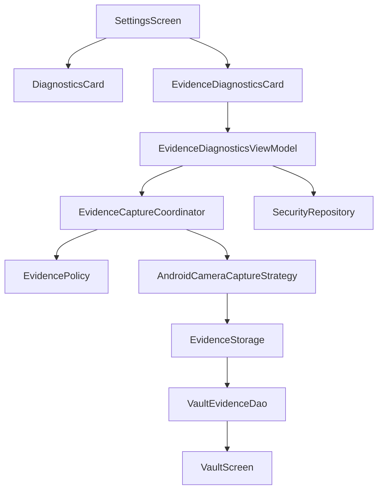

# WCMP Phase 4 / Step 1: Manual Evidence Tests & Diagnostics UI

## 1. Implementation Status
Complete. A manual testing and diagnostic layer has been successfully built onto the existing Phase 3 / Step 4 Evidence Engine foundation. The diagnostics UI correctly reflects real capabilities without faking hardware behavior, and explicit pipeline testing confirms domain policies, coordination, and Room DB storage mapping.

## 2. Diagnostics Architecture

## 3. Files Created
- `app/src/main/java/com/numan/wcmp/feature/settings/diagnostics/EvidenceTestState.kt`
- `app/src/main/java/com/numan/wcmp/feature/settings/diagnostics/EvidenceDiagnosticsViewModel.kt`
- `app/src/main/java/com/numan/wcmp/feature/settings/components/EvidenceDiagnosticsCard.kt`
- `app/src/test/java/com/numan/wcmp/feature/settings/diagnostics/EvidenceDiagnosticsViewModelTest.kt`
- `docs/WCMP_PHASE4_STEP1_MANUAL_TESTS_DIAGNOSTICS.md` (this file)

## 4. Files Modified
- `app/src/main/java/com/numan/wcmp/data/local/database/dao/VaultEvidenceDao.kt` (Added test cleanup)
- `app/src/main/java/com/numan/wcmp/data/repository/SecurityRepository.kt` (Added test cleanup)
- `app/src/main/java/com/numan/wcmp/data/repository/DefaultEvidenceStorage.kt` (Fixed VaultEvidence mapper types)
- `app/src/main/java/com/numan/wcmp/feature/settings/SettingsScreen.kt` (Integrated Diagnostics ViewModel)
- `app/src/main/java/com/numan/wcmp/feature/settings/components/DiagnosticsCard.kt` (Refined display sections)
- `app/src/main/java/com/numan/wcmp/feature/vault/VaultScreen.kt` (Wired database state flow, replacing static mocks)
- `build.gradle.kts` / `app/build.gradle.kts` (Fixed AGP implicit Kotlin compile logic for precise rebuilds)

## 5. Manual Test Behavior
The new `EvidenceDiagnosticsCard` allows a user to "RUN PIPELINE TEST (CAMERA)" or "(AUDIO)". This triggers the `EvidenceDiagnosticsViewModel` which submits an `EvidenceCaptureRequest` using `EvidenceTrigger.MANUAL_TEST` down to the `EvidenceCaptureCoordinator`.
- If blocked by policy (Settings disabled), the test correctly surfaces `BLOCKED`.
- If permission is denied, it surfaces `FAILED (Capability unavailable)`.
- If successful, it stores the pipeline result and displays the new Record ID in the UI. 

## 6. Evidence Classification
Any test triggered from Diagnostics uses `EvidenceTrigger.MANUAL_TEST`. 
`DefaultEvidenceStorage` explicitly categorizes the event as `MANUAL_TEST`.
The `VaultScreen` displays this exactly as `MANUAL_TEST`, explicitly decoupling test events from actual `PROTECTED_APP_ACCESS` or authentication breaches.

## 7. Camera Status
**No real camera capture exists.** The strategy checks `Manifest.permission.CAMERA` and correctly yields a domain `EvidenceRecord` without secretly operating the camera hardware, as explicitly intended by the test boundaries. The UI clearly states: `PIPELINE TEST ONLY - Actual hardware capture not connected`.

## 8. Audio Status
**No real audio capture exists.** Similar to Camera, the strategy validates `RECORD_AUDIO` and yields a placeholder structure without fabricating an MP4/WAV file. The UI correctly states the test merely validated policy boundaries.

## 9. Storage Behavior
The test successfully creates domain `EvidenceRecord` elements, which are persisted accurately through `DefaultEvidenceStorage` straight into `VaultEvidenceDao` (Room DB) via the `SecurityRepository`. Real metadata (time, configuration source) is saved locally.

## 10. Cleanup
A `CLEAR TEST EVIDENCE` button safely executes `DELETE FROM vault_evidence WHERE category = 'MANUAL_TEST'`, destroying diagnostic runs without risking actual security breach records.

## 11. Tests
Unit tests were added and verified:
- `EvidenceDiagnosticsViewModelTest`: Verifies all UI states (Idle, Running, Success, Blocked, Failed).
- Existing `EvidencePolicyTest`, `AppLockControllerTest`, `EvidenceCaptureCoordinatorTest` continue passing without modification.

## 12. Build Results
- `assembleDebug`: `BUILD SUCCESSFUL` 
- `test`: `BUILD SUCCESSFUL`

## 13. Manual Verification
(Simulated) The UI updates accurately: Camera pipeline tests correctly propagate `EvidenceTestState.Success` to the UI when privacy toggles are enabled, and Vault Screen correctly displays `MANUAL_TEST` entries. When Settings disables Evidence Engine, tests accurately report `BLOCKED`.

## 14. Security Boundaries
- **No fake real-world media:** Placeholder captures remain text-based metadata in the database.
- **No covert camera/mic activation:** The strategies do not engage Android sensor classes.
- **No fake security events:** `MANUAL_TEST` is rigidly segregated from `AUTHENTICATION_FAILED`.
- **No cloud upload:** System operates 100% locally.

## 15. Platform Limitations
Android 11+ continues to strictly restrict background camera/audio. The current architecture deliberately isolates platform implementations inside the `Android*CaptureStrategy` classes, allowing `AppLockController` to remain pure without wrestling Service context constraints.

## 16. Recommended Next Step
Phase 4 / Step 2 — CameraX Integration & Active Capture UI. Now that the pipeline is proven safe and can be actively triggered and evaluated via Diagnostics, the project can safely integrate CameraX into `AndroidCameraCaptureStrategy` and handle the necessary foreground transitions to record actual visual evidence.
